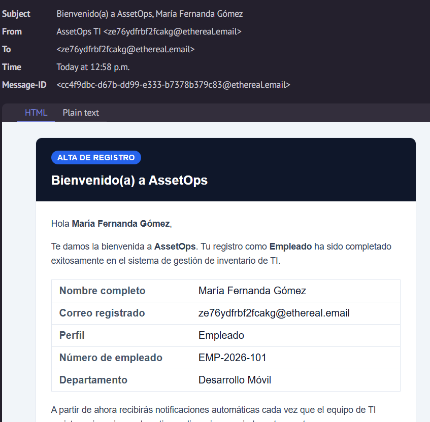
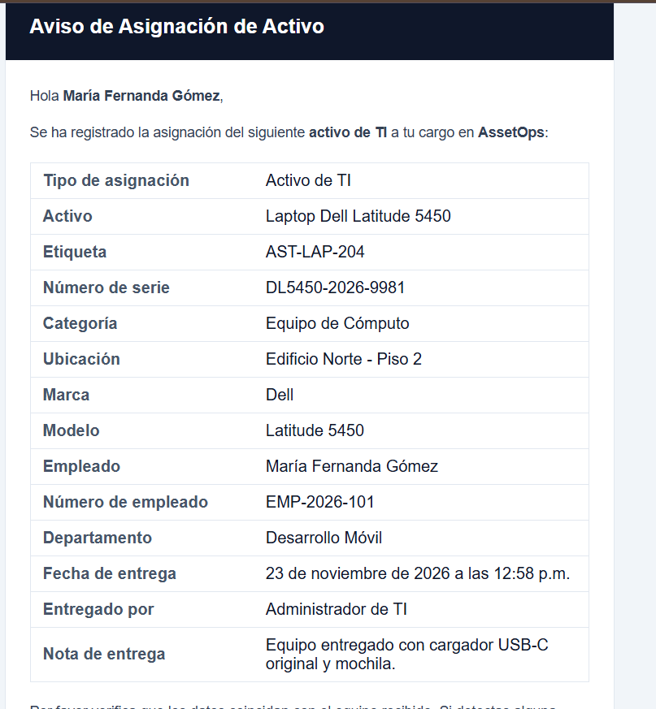
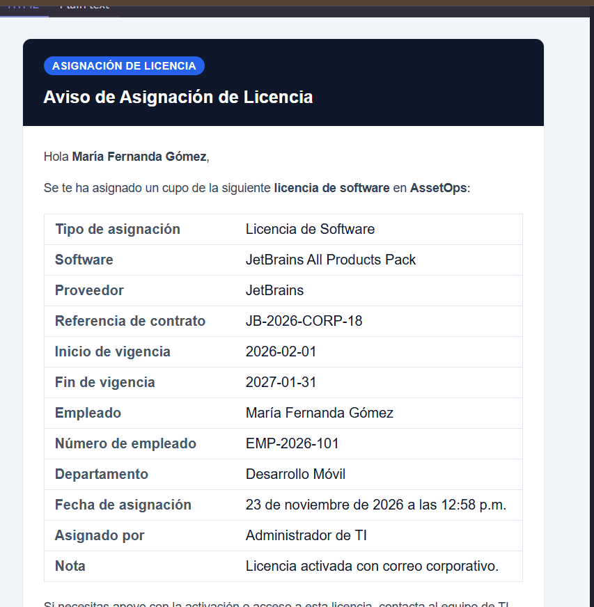

# Documentación Técnica — Backend de Correo SMTP (Sprint 2: HU03 y HU06)

Este documento describe de forma completa la arquitectura, implementación, configuración del servidor de correo utilizado, flujo de funcionamiento de **HU03** y **HU06**, y las **pruebas con evidencias reales** ejecutadas en el repositorio `inventarioBackend` (AssetOps).

---

## 1. Objetivo y Alcance (Sprint 2)

Se implementó el subsistema de notificaciones por correo electrónico mediante **SMTP + Nodemailer** para cubrir dos historias de usuario del Sprint 2:

- **HU03 — Correo de bienvenida opcional:** Permite enviar un correo de bienvenida al dar de alta un empleado o usuario administrador, controlado por una bandera opcional (`enviarCorreo`) y/o variable global (`MAIL_WELCOME_ENABLED`), tolerando fallos de red/SMTP sin interrumpir el flujo principal.
- **HU06 — Aviso automático al asignar:** Envía automáticamente una notificación HTML (y respaldo en texto plano) al empleado cada vez que se le asigna un **activo de TI** (`ACTIVO`) o una **licencia de software** (`LICENCIA`), incluyendo todos los datos relevantes de la asignación.

---

## 2. Arquitectura Aplicada (Clean Architecture + CQRS + SOLID)

La implementación sigue estrictamente las **4 capas** y el patrón **CQRS** ya establecidos en el proyecto, sin alterar módulos ajenos (como autenticación o base de datos):

```text
Cliente / Módulo del Backend (POST /api/notificaciones/* o invocación directa de Handler)
       ↓
[Capa 4 — Presentación]
  • notificationRoutes.ts      -> Protege rutas con authMiddleware (JWT)
  • validarBody.ts             -> Aplica el validador del caso de uso (400 si falla)
  • NotificationController.ts  -> Construye el Command CQRS y delega al Handler
       ↓
[Capa 2 — Aplicación (CQRS Commands)]
  • SendWelcomeEmailCommand    -> SendWelcomeEmailHandler   (HU03)
  • SendAssignmentNoticeCommand-> SendAssignmentNoticeHandler (HU06)
       ↓  (dependen únicamente de contratos de Capa 1 — DIP)
[Capa 1 — Dominio]
  • IMailService               -> Contrato de envío y verificación SMTP
  • IMailTemplateRenderer      -> Contrato de renderizado HTML / texto plano
       ↓  (implementados e inyectados desde container.ts)
[Capa 3 — Infraestructura]
  • config/mail.ts             -> Carga variables de entorno SMTP
  • MailTemplateRenderer.ts    -> Genera plantillas HTML seguras (escape XSS) + texto plano
  • NodemailerMailService.ts   -> Adaptador SMTP con Nodemailer
       ↓
Servidor SMTP externo (Ethereal Email en pruebas / Gmail o SMTP corporativo en producción)
```

### Principios SOLID aplicados
- **S (Single Responsibility):** `MailTemplateRenderer` solo construye plantillas; `NodemailerMailService` solo maneja transporte SMTP; cada Command Handler orquesta únicamente su historia de usuario.
- **O (Open/Closed):** Para migrar de Nodemailer a otro proveedor (SendGrid, AWS SES, Resend) basta crear una nueva clase que implemente `IMailService` sin tocar los handlers.
- **L (Liskov Substitution):** Cualquier implementación de `IMailService` (real o mock) es intercambiable dentro de `SendWelcomeEmailHandler` y `SendAssignmentNoticeHandler`.
- **I (Interface Segregation):** Los contratos de correo se mantienen en `src/domain/contracts/mail.ts`, separados de los contratos de autenticación (`IUserRepository`, `ITokenService`, etc.).
- **D (Dependency Inversion):** Los handlers dependen exclusivamente de `IMailService` e `IMailTemplateRenderer`; el ensamblado concreto ocurre únicamente en el Composition Root (`src/infrastructure/config/container.ts`).

---

## 3. Qué servicio y cuentas de correo se utilizaron

### 3.1. Proveedor SMTP usado en las pruebas: **Ethereal Email**
Para comprobar el envío real a través del protocolo SMTP **sin exponer contraseñas personales ni enviar correos basura a terceros**, se utilizó **Ethereal Email** (`https://ethereal.email/`), el servicio SMTP de pruebas oficial mantenido por el equipo de Nodemailer.

¿Cómo funciona Ethereal Email?
- Recibe correos reales por el protocolo **SMTP auténtico** (`smtp.ethereal.email`, puerto `587`, cifrado STARTTLS con `SMTP_SECURE=false`).
- Ejecuta el handshake completo, valida usuario/contraseña y acepta el mensaje igual que Gmail o un servidor corporativo.
- En lugar de entregarlo a internet abierto, lo almacena en una **bandeja web privada de pruebas** y devuelve una URL directa (`previewUrl`) para inspeccionar el correo real (cabeceras `Subject`, `From`, `To`, `Message-ID`, vista `HTML` y vista `Plain text`).

### 3.2. Cuentas de prueba exactas utilizadas durante la verificación

| Corrida de prueba | Servidor SMTP | Puerto / TLS | Cuenta de correo (Remitente y Destino) | Propósito |
| --- | --- | --- | --- | --- |
| **Prueba CLI** (`npm run mail:test`) | `smtp.ethereal.email` | `587` (`secure=false`) | `whwyexyz3546cwxa@ethereal.email` | Validar conexión SMTP, HU03 (omitido y enviado), HU06 (activo y licencia) y resiliencia ante fallos. |
| **Prueba E2E HTTP + SMTP** (capturas de evidencia) | `smtp.ethereal.email` | `587` (`secure=false`) | `ze76ydfrbf2fcakg@ethereal.email` (`AssetOps TI <ze76ydfrbf2fcakg@ethereal.email>`) | Validar el ciclo completo Express + JWT + Zod + Handlers CQRS + entrega SMTP real. |

> **Nota sobre la automatización de cuentas de prueba:** El script `scripts/probarCorreo.ts` lee primero las variables de `.env`. Si `SMTP_USER` y `SMTP_PASS` están vacíos (o si se ejecuta con `--ethereal`), crea automáticamente una cuenta temporal en Ethereal mediante `nodemailer.createTestAccount()` para poder probar el envío real de inmediato.

### 3.3. Compatibilidad con Gmail y otros servidores SMTP reales
El adaptador `NodemailerMailService` es 100% agnóstico del proveedor. Para enviar a correos reales (por ejemplo, Gmail o correo institucional), solo se cambian las variables en `.env` sin modificar código:

| Variable | Ejemplo Ethereal (Pruebas) | Ejemplo Gmail Real (App Password) |
| --- | --- | --- |
| `SMTP_HOST` | `smtp.ethereal.email` | `smtp.gmail.com` |
| `SMTP_PORT` | `587` | `465` |
| `SMTP_SECURE` | `false` | `true` |
| `SMTP_USER` | `usuario@ethereal.email` | `tu_correo@gmail.com` |
| `SMTP_PASS` | `clave_ethereal` | `xxxx xxxx xxxx xxxx` *(Contraseña de Aplicación de 16 caracteres)* |
| `SMTP_FROM` | `"AssetOps TI <usuario@ethereal.email>"` | `"AssetOps TI <tu_correo@gmail.com>"` |
| `MAIL_WELCOME_ENABLED` | `true` | `true` |
| `SMTP_TEST_TO` | `usuario@ethereal.email` | `destinatario_prueba@gmail.com` |

---

## 4. Funcionamiento detallado de HU03 y HU06

### 4.1. HU03 — Correo de bienvenida opcional
- **Ruta HTTP:** `POST /api/notificaciones/bienvenida` (requiere `Authorization: Bearer <JWT>`).
- **Regla de opcionalidad:** `const shouldSend = command.enviarCorreo ?? mailConfig.welcomeEnabledByDefault`.
  - Si `enviarCorreo` es `false` (o no se envía y `MAIL_WELCOME_ENABLED=false`), retorna `HTTP 200` con `status: "SKIPPED"` y `sent: false` sin contactar el servidor SMTP.
  - Si está habilitado, renderiza la plantilla HTML de **ALTA DE REGISTRO** y envía el correo.
- **Tolerancia a fallos (resiliencia):** Si el servidor SMTP está caído, no hay red o faltan credenciales, `SendWelcomeEmailHandler` captura el error en un bloque `try/catch`, registra una advertencia en consola (`console.warn`) y retorna `{ status: "FAILED", sent: false, reason }` **sin lanzar excepción**, protegiendo el flujo principal de registro de empleados/usuarios.

**Ejemplo de payload JSON (`POST /api/notificaciones/bienvenida`):**
```json
{
  "nombre": "María Fernanda Gómez",
  "correo": "ze76ydfrbf2fcakg@ethereal.email",
  "tipoDestinatario": "EMPLEADO",
  "enviarCorreo": true,
  "numeroEmpleado": "EMP-2026-101",
  "departamento": "Desarrollo Móvil"
}
```

### 4.2. HU06 — Aviso automático al asignar
- **Ruta HTTP:** `POST /api/notificaciones/asignacion` (requiere `Authorization: Bearer <JWT>`).
- **Soporte dual (unión discriminada por `tipo`):**
  1. `tipo: "ACTIVO"`: Incluye nombre del activo, etiqueta, número de serie, categoría, ubicación, marca, modelo, datos del empleado, fecha de entrega, responsable y nota.
  2. `tipo: "LICENCIA"`: Incluye nombre del software, proveedor, referencia de contrato, inicio/fin de vigencia, datos del empleado, fecha de asignación, responsable y nota.
- **Seguridad en plantilla:** Todos los campos dinámicos pasan por `escapeHtml()` antes de insertarse en el HTML para evitar inyección de código/XSS en el correo.
- **Tolerancia a fallos:** Al igual que HU03, un fallo SMTP retorna `{ status: "FAILED", sent: false, reason }` sin tumbar ni revertir la transacción principal de asignación en base de datos.

**Ejemplo de payload JSON para Activo (`POST /api/notificaciones/asignacion`):**
```json
{
  "tipo": "ACTIVO",
  "nombreEmpleado": "María Fernanda Gómez",
  "correoEmpleado": "ze76ydfrbf2fcakg@ethereal.email",
  "numeroEmpleado": "EMP-2026-101",
  "departamento": "Desarrollo Móvil",
  "asignadoPor": "Administrador de TI",
  "nota": "Equipo entregado con cargador USB-C original y mochila.",
  "detalle": {
    "nombreActivo": "Laptop Dell Latitude 5450",
    "etiqueta": "AST-LAP-204",
    "numeroSerie": "DL5450-2026-9981",
    "categoria": "Equipo de Cómputo",
    "ubicacion": "Edificio Norte - Piso 2",
    "marca": "Dell",
    "modelo": "Latitude 5450"
  }
}
```

**Ejemplo de payload JSON para Licencia (`POST /api/notificaciones/asignacion`):**
```json
{
  "tipo": "LICENCIA",
  "nombreEmpleado": "María Fernanda Gómez",
  "correoEmpleado": "ze76ydfrbf2fcakg@ethereal.email",
  "numeroEmpleado": "EMP-2026-101",
  "departamento": "Desarrollo Móvil",
  "asignadoPor": "Administrador de TI",
  "nota": "Licencia activada con correo corporativo.",
  "detalle": {
    "software": "JetBrains All Products Pack",
    "proveedor": "JetBrains",
    "referenciaContrato": "JB-2026-CORP-18",
    "inicioVigencia": "2026-02-01",
    "finVigencia": "2027-01-31"
  }
}
```

### 4.3. Endpoint rápido de diagnóstico
- **Ruta HTTP:** `POST /api/notificaciones/prueba` (requiere `Authorization: Bearer <JWT>`).
- Permite disparar rápidamente un correo de verificación (`BIENVENIDA`, `ASIGNACION_ACTIVO` o `ASIGNACION_LICENCIA`) hacia cualquier `correoDestino`.

---

## 5. Pruebas Realizadas y Resultados

Se ejecutaron **3 niveles de verificación** para comprobar tanto la calidad estática del código como la entrega real de correos por SMTP y el flujo HTTP completo.

### 5.1. Prueba 1 — Validación de Tipos TypeScript
Comando ejecutado:
```bash
npm run typecheck
```
- **Resultado:** Aprobado sin errores (`0` errores en `src/**/*.ts` y `scripts/probarCorreo.ts`).

### 5.2. Prueba 2 — Script CLI de Verificación SMTP (`npm run mail:test`)
Comando ejecutado:
```bash
npm run mail:test
```
Cuenta Ethereal generada: `whwyexyz3546cwxa@ethereal.email` (`smtp.ethereal.email:587`).

| # | Prueba ejecutada | Estado | Enviado | Message-ID / Vista previa Ethereal |
| :---: | --- | :---: | :---: | --- |
| 1 | Conexión y autenticación SMTP | `OK` | — | Handshake TLS verificado en `smtp.ethereal.email:587` |
| 2 | **HU03** Bienvenida opcional desactivada (`enviarCorreo: false`) | `SKIPPED` | `false` | Omitido sin llamar a SMTP |
| 3 | **HU03** Correo de bienvenida enviado | `SENT` | `true` | `<2ff35be6-65c0-9e66-8d28-50e8e44f2486@assetops.test>` ([Ver correo](https://ethereal.email/message/awSLZOiVxZpKoIQrawSLaHM3WywC76xvAAAAAbZmvOfRmZm33-DOmfQ3GyI)) |
| 4 | **HU06** Aviso automático de asignación de Activo | `SENT` | `true` | `<07ae33f9-2ad7-0cd5-9064-ace39558efdf@assetops.test>` ([Ver correo](https://ethereal.email/message/awSLZOiVxZpKoIQrawSLatT-eTqTJnCGAAAAAsqzyeSJFc00z7ITYc-VxUY)) |
| 5 | **HU06** Aviso automático de asignación de Licencia | `SENT` | `true` | `<46d1d283-6fdb-efd6-f7eb-181579670a01@assetops.test>` ([Ver correo](https://ethereal.email/message/awSLZOiVxZpKoIQrawSLbXnSi3L0c89tAAAAAwBBibv.0qEOJjmFUxvaIeU)) |
| 6 | Resiliencia sin SMTP configurado | `FAILED` | `false` | Error capturado con `console.warn`; el flujo principal no cayó |

### 5.3. Prueba 3 — Prueba End-to-End HTTP (Express + JWT + Zod + SMTP Real)
Se levantó el servidor Express real (`src/app.ts`) con el contenedor de dependencias (`src/infrastructure/config/container.ts`) conectado a la cuenta Ethereal **`ze76ydfrbf2fcakg@ethereal.email`** (`smtp.ethereal.email:587`) y se ejecutaron **8 peticiones HTTP reales**:

| # | Caso probado | HTTP | Estado devuelto | Enviado | Enlace Ethereal |
| :---: | --- | :---: | :---: | :---: | --- |
| 1 | `GET /health` | `200` | `OK` | — | — |
| 2 | `POST /api/notificaciones/bienvenida` sin token JWT | `401` | `BLOQUEADO_401` | `false` | — |
| 3 | `POST /api/notificaciones/bienvenida` con correo inválido (Zod) | `400` | `VALIDACION_400` | `false` | — |
| 4 | **HU03** `POST /api/notificaciones/bienvenida` (`enviarCorreo: false`) | `200` | `SKIPPED` | `false` | — |
| 5 | **HU03** `POST /api/notificaciones/bienvenida` (`enviarCorreo: true`) | `200` | `SENT` | `true` | [Ver correo HU03](https://ethereal.email/message/awSM1uiVxZpKoK1IawSM23M3WywC760cAAAAAYYoc3qL.5G1pyo33mlnYxI) |
| 6 | **HU06** `POST /api/notificaciones/asignacion` (`tipo: "ACTIVO"`) | `200` | `SENT` | `true` | [Ver correo Activo](https://ethereal.email/message/awSM1uiVxZpKoK1IawSM3nM3WywC760gAAAAAhzqYtk5ClY0XjaP6Ix3slo) |
| 7 | **HU06** `POST /api/notificaciones/asignacion` (`tipo: "LICENCIA"`) | `200` | `SENT` | `true` | [Ver correo Licencia](https://ethereal.email/message/awSM1uiVxZpKoK1IawSM4XM3WywC760kAAAAAyqnr8lLziVRTKlFQayuMCE) |
| 8 | Diagnóstico `POST /api/notificaciones/prueba` | `200` | `SENT` | `true` | [Ver correo Prueba](https://ethereal.email/message/awSM1uiVxZpKoK1IawSM43nSi3L0c9AgAAAABEULgcyiV5DoVxA6HuJs13g) |

**Resultado global E2E:** **8/8 casos aprobados.**

---

## 6. Evidencias Visuales de Correos Entregados

A continuación se muestran las capturas reales obtenidas desde la bandeja de **Ethereal Email** (`ze76ydfrbf2fcakg@ethereal.email`) tras ejecutar la prueba end-to-end.

### 6.1. Evidencia HU03 — Correo de Bienvenida (Alta de Registro)
Se confirma la entrega del correo con asunto `Bienvenido(a) a AssetOps, María Fernanda Gómez`, remitente `AssetOps TI <ze76ydfrbf2fcakg@ethereal.email>`, destinatario `<ze76ydfrbf2fcakg@ethereal.email>`, `Message-ID: <cc4f9dbc-d67b-dd99-e333-b7378b379c83@ethereal.email>`, insignia `ALTA DE REGISTRO` y tabla HTML con los datos del empleado (`EMP-2026-101`, `Desarrollo Móvil`).



### 6.2. Evidencia HU06 — Aviso Automático de Asignación de Activo
Se confirma el envío automático con todos los datos relevantes del equipo asignado (`Laptop Dell Latitude 5450`, etiqueta `AST-LAP-204`, serie `DL5450-2026-9981`, categoría, ubicación, marca, modelo, empleado, fecha/hora de entrega, responsable y nota de entrega).



### 6.3. Evidencia HU06 — Aviso Automático de Asignación de Licencia
Se confirma el envío automático con la insignia `ASIGNACIÓN DE LICENCIA` y el detalle completo del software asignado (`JetBrains All Products Pack`, proveedor `JetBrains`, contrato `JB-2026-CORP-18`, vigencia `2026-02-01` a `2027-01-31`, datos del empleado, responsable y nota).



---

## 7. Inventario de Archivos y Dependencias

### 7.1. Archivos creados

| Ruta | Capa | Responsabilidad |
| --- | --- | --- |
| `src/domain/contracts/mail.ts` | Dominio | Interfaces `IMailService`, `IMailTemplateRenderer` y DTOs (`MailMessage`, `EmailDispatchResult`, `WelcomeEmailData`, `AssignmentNoticeData`). |
| `src/application/notifications/commands/correo-bienvenida/SendWelcomeEmailCommand.ts` | Aplicación | Command DTO para correo de bienvenida opcional (HU03). |
| `src/application/notifications/commands/correo-bienvenida/SendWelcomeEmailHandler.ts` | Aplicación | Caso de uso HU03 con control opcional y tolerancia a fallos SMTP. |
| `src/application/notifications/commands/aviso-asignacion/SendAssignmentNoticeCommand.ts` | Aplicación | Command DTO para aviso automático de asignación de activo o licencia (HU06). |
| `src/application/notifications/commands/aviso-asignacion/SendAssignmentNoticeHandler.ts` | Aplicación | Caso de uso HU06 que renderiza y despacha el aviso automático con manejo seguro de errores. |
| `src/infrastructure/config/mail.ts` | Infraestructura | Lectura y normalización de variables de entorno SMTP (`loadMailConfig`, `mailConfig`). |
| `src/infrastructure/services/NodemailerMailService.ts` | Infraestructura | Adaptador SMTP con Nodemailer implementando `IMailService`. |
| `src/infrastructure/services/MailTemplateRenderer.ts` | Infraestructura | Renderizador seguro de plantillas HTML y texto plano para HU03 y HU06. |
| `src/presentation/middlewares/validarBody.ts` | Presentación | Aplica los esquemas Zod de bienvenida, asignación y prueba que viven en sus carpetas de aplicación. |
| `src/presentation/controllers/NotificationController.ts` | Presentación | Controlador factory (`enviarBienvenida`, `enviarAvisoAsignacion`, `probarEnvio`). |
| `src/presentation/routes/notificationRoutes.ts` | Presentación | Enrutador Express `/api/notificaciones/*` protegido con `authMiddleware`. |
| `scripts/probarCorreo.ts` | Verificación / CLI | Script standalone (`npm run mail:test`) para validar SMTP, HU03, HU06 y resiliencia. |
| `docs/correo-smtp-hu03-hu06.md` | Documentación | Este documento técnico completo con evidencias. |
| `docs/evidencias/hu03-correo-bienvenida.png` | Evidencias | Captura real del correo HTML de bienvenida (HU03). |
| `docs/evidencias/hu06-aviso-asignacion-activo.png` | Evidencias | Captura real del aviso HTML de asignación de activo (HU06). |
| `docs/evidencias/hu06-aviso-asignacion-licencia.png` | Evidencias | Captura real del aviso HTML de asignación de licencia (HU06). |

### 7.2. Archivos modificados

| Ruta | Cambios realizados |
| --- | --- |
| `src/domain/contracts/index.ts` | Reexportación de los contratos y tipos de `./mail.js` (líneas 51-69). |
| `src/infrastructure/config/container.ts` | Registro e inyección en el Composition Root de `mailService`, `mailTemplateRenderer`, `sendWelcomeEmailHandler`, `sendAssignmentNoticeHandler` y `notificationController` (líneas 9-52). |
| `src/app.ts` | Importación y montaje de `notificationRoutes` en `/api/notificaciones` (líneas 3 y 24). |
| `server.ts` | Lectura de `mailConfig` y despliegue del estado SMTP y ruta `/api/notificaciones` en el banner de arranque (líneas 4 y 21-35). |
| `.env.example` | Plantilla documentada de variables SMTP para Ethereal y Gmail (líneas 15-31). |
| `.env` | Adición de variables base SMTP conservando intactas las de PostgreSQL y JWT (líneas 8-16). |
| `package.json` | Adición del script `"mail:test": "tsx scripts/probarCorreo.ts"` y dependencias de Nodemailer. |
| `package-lock.json` | Actualización automática del árbol de dependencias. |
| `docs/README.md` | Inclusión del módulo de correo SMTP (HU03 y HU06) en el mapa general de documentación y tecnologías. |

### 7.3. Dependencias nuevas instaladas
- **`nodemailer`**: `10.6.1` (`dependencies`)
- **`@types/nodemailer`**: `8.0.2` (`devDependencies`)

---

## 8. Cómo ejecutar las pruebas e integrar con futuros módulos del Sprint 2

### 8.1. Ejecutar la comprobación desde terminal
```powershell
# 1. Validar tipos TypeScript
npm run typecheck

# 2. Probar envío SMTP real (usa .env o crea cuenta temporal Ethereal automáticamente)
npm run mail:test

# 3. Forzar cuenta temporal Ethereal aunque .env tenga credenciales
npm run mail:test -- --ethereal

# 4. Enviar prueba a un destinatario específico (requiere SMTP real en .env)
npm run mail:test -- --to=correo_destino@gmail.com
```

### 8.2. Integración directa desde futuros Command Handlers (Empleados / Asignaciones)
Cuando se implementen los comandos de alta de empleados y asignación de activos/licencias, solo basta inyectar `sendWelcomeEmailHandler` o `sendAssignmentNoticeHandler` desde `src/infrastructure/config/container.ts`:

```ts
// En CreateEmployeeHandler (HU03):
await this.sendWelcomeEmailHandler.handle(
  new SendWelcomeEmailCommand(
    empleado.nombre,
    empleado.correo,
    'EMPLEADO',
    command.enviarCorreoBienvenida, // boolean opcional
    empleado.numeroEmpleado,
    empleado.departamento ?? undefined,
  ),
);

// En AssignAssetHandler (HU06):
await this.sendAssignmentNoticeHandler.handle(
  new SendAssignmentNoticeCommand({
    tipo: 'ACTIVO',
    nombreEmpleado: empleado.nombre,
    correoEmpleado: empleado.correo,
    numeroEmpleado: empleado.numeroEmpleado,
    departamento: empleado.departamento ?? undefined,
    fechaAsignacion: asignacion.entregadoEn,
    asignadoPor: usuarioEntrega.nombre,
    nota: asignacion.notaEntrega ?? undefined,
    detalle: {
      nombreActivo: activo.nombre,
      etiqueta: activo.etiqueta,
      numeroSerie: activo.numeroSerie,
      categoria: activo.categoria,
      ubicacion: activo.ubicacion,
      marca: activo.marca ?? undefined,
      modelo: activo.modelo ?? undefined,
    },
  }),
);
```
